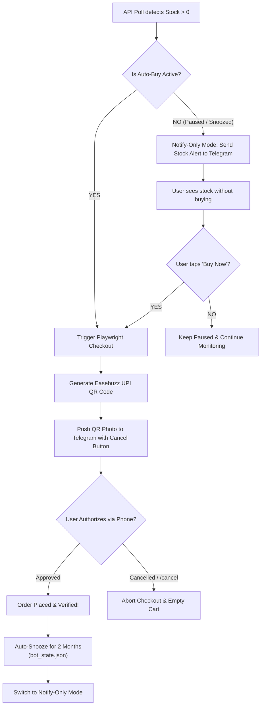

# 🥛 Amul Stock Monitor & Auto-Checkout Bot

A high-performance Python automation bot for **Amul's e-commerce platform (`shop.amul.com`)**, specifically designed to monitor stock for high-demand products like **Amul Chocolate Whey Protein (Pack of 60 sachets)**, trigger rapid checkout with automated UPI payment dispatch as soon as stock becomes available, and provide **interactive Telegram remote controls to snooze/timeout purchases for 1, 2, or 3 months in Notify-Only Mode**.

---

## ⚡ Key Features

1. **Direct JSON API Polling (No HTML Scraping):**
   - Polls Amul's internal StoreHippo REST API (`/api/1/entity/ms.products`) every 60 seconds (configurable).
   - Injects regional `substore` ID for hyperlocal warehouse inventory matching.
   - Automatically computes dynamic StoreHippo `tid` security tokens using reverse-engineered SHA-256 HMAC headers.

2. **Authenticated Session Management:**
   - Injects pre-authenticated browser cookies from `cookies.json` into Playwright.
   - Completely bypasses OTP verification and manual phone logins at runtime.

3. **Instant UPI Checkout & QR Auto-Push:**
   - Detects `stock > 0` and triggers stealth Playwright automation in milliseconds.
   - Adds product to cart (UI action with fallback to `ms.cart.addItem` API call).
   - Selects saved delivery address, launches the payment gateway (Easebuzz / PhonePe), and generates a scannable **Dynamic UPI QR Code**.
   - Instantly transmits the QR code photo directly to your **Telegram** chat with an urgent sound alert.
   - You only need to scan the QR code with any UPI app (GPay / PhonePe / Paytm / Cred) and enter your PIN on your phone!

4. **📱 Interactive Telegram Remote Controls & Purchase Timeouts:**
   - **Timeout / Snooze Auto-Purchases:** When you've stocked up on protein powder and don't want the bot to buy more, snooze auto-purchases for **1 month, 2 months, 3 months**, or custom durations directly via Telegram.
   - **🔔 Notify-Only Mode While Paused:** The bot continues polling stock 24/7! When stock arrives while snoozed, it sends a stock alert to your Telegram without placing an order.
   - **⚡ 1-Tap Buy Now Override:** Each notify-only alert includes a `[ ⚡ Buy Now (Resume) ]` button to instantly purchase if you decide you want it after all.
   - **❌ Instant Cancel:** Cancel any active checkout or payment QR immediately using `/cancel` or the `[ ❌ Cancel This Purchase ]` button directly under the QR code photo.
   - **Post-Purchase Auto-Snooze:** After successfully placing an order, the bot automatically snoozes auto-purchase for 2 months (customizable in `.env`), preventing unwanted duplicate orders while your supply lasts.

5. **Anti-Detection & Residential Emulation:**
   - Powered by `playwright-stealth`.
   - Mimics residential Chromium traffic: custom viewport, `en-IN` locale, `Asia/Kolkata` timezone, and disabled automation flags (`AutomationControlled`).

---

## 📱 Telegram Remote Commands

You can control the bot at any time by sending commands to your Telegram bot:

| Command | Action |
|---|---|
| `/status` | View current bot status, auto-buy mode (active vs paused with countdown), stock, pincode, and substore |
| `/pause 1m` | Timeout/pause auto-purchases for **1 month** (30 days) |
| `/pause 2m` | Timeout/pause auto-purchases for **2 months** (60 days) |
| `/pause 3m` | Timeout/pause auto-purchases for **3 months** (90 days) |
| `/pause [time]` | Custom timeout, e.g. `/pause 15d`, `/pause 45d`, `/pause indefinite` |
| `/pause` | Opens interactive buttons: `[ ⏸️ 1 Month ]` `[ ⏸️ 2 Months ]` `[ ⏸️ 3 Months ]` `[ ▶️ Resume ]` |
| `/resume` | Resume auto-purchases immediately |
| `/cancel` | Cancel any current purchase/payment authorization in progress and clear cart |
| `/emptycart` | Clear all items from your Amul shopping cart on demand |
| `/help` | Display list of commands and instructions |

> **Security Note:** The bot will strictly only respond to commands sent from your configured `TELEGRAM_CHAT_ID`. Any unauthorized users will be ignored.

---

## 📁 Project Structure

```text
.
├── main.py              # Main monitoring orchestrator and event loop
├── state_manager.py     # State persistence for auto-buy snooze timeouts (bot_state.json)
├── telegram_control.py  # Telegram interactive command handler & inline keyboard controller
├── monitor.py           # Internal StoreHippo API poller and token generator
├── checkout.py          # Playwright stealth auto-checkout engine with cancel support
├── notifier.py          # Telegram notification handler with inline buttons & QR push
├── requirements.txt     # Python dependencies
├── .env.example         # Configuration template
├── cookies.json.example # Sample cookies format
└── README.md            # Detailed setup and usage guide
```

---

## 🛠️ Installation & Setup

### 1. Clone & Enter Directory
```bash
git clone <your-repo-or-path>
cd Automation
```

### 2. Create Virtual Environment & Install Dependencies
```bash
python3 -m venv venv
source venv/bin/activate
pip install -r requirements.txt
playwright install chromium
```

### 3. Configure Environment Variables
Copy `.env.example` to `.env`:
```bash
cp .env.example .env
```

Edit `.env` with your values:
```env
AMUL_SUBSTORE_ID=66505ff8c8f2d6e221b9180c
DELIVERY_PINCODE=201310
TELEGRAM_BOT_TOKEN=your_bot_token
TELEGRAM_CHAT_ID=your_chat_id
DEFAULT_POST_PURCHASE_PAUSE_MONTHS=2
NOTIFY_ONLY_ALERT_INTERVAL_MINUTES=30
```

---

## 🔍 How to Find Your Substore ID

Amul uses **StoreHippo's multi-store hyperlocal architecture**. Availability is strictly tied to a regional `substore` ID mapped to your delivery pincode.

1. Open your browser (Chrome/Edge/Firefox) and navigate to [shop.amul.com](https://shop.amul.com).
2. Press `F12` (or right-click anywhere and choose **Inspect**) to open Developer Tools.
3. Switch to the **Network** tab and filter by **Fetch/XHR**.
4. On the Amul website:
   - Click the **Select Pincodes / Location** widget at the top.
   - Enter your delivery pincode (e.g. `201310`).
   - Select your address from the dropdown suggestions.
5. In the Developer Tools Network filter, type `ms.products`.
6. Look for URLs ending with `substore=...`, for example:
   ```text
   https://shop.amul.com/api/1/entity/ms.products?...&substore=66505ff8c8f2d6e221b9180c
   ```
7. Copy the 24-character hexadecimal ID after `substore=` and paste it into `.env`.

*Common Regional Substore IDs:*
- **Noida / Gr. Noida (201310):** `66505ff8c8f2d6e221b9180c`
- **Delhi / NCR:** `66505ff5145c16635e6cc74d`
- **Bangalore:** `66505ff0998183e1b1935c75`
- **Mumbai:** `66506004a7cddee1b8adb014`

---

## 🍪 How to Extract Cookies into `cookies.json`

To bypass OTP login at runtime, export your active session cookies from your desktop browser.

### Using the "Cookie-Editor" Extension (Recommended)
1. Install **Cookie-Editor** in your browser:
   - [Chrome Web Store](https://chromewebstore.google.com/detail/cookie-editor/hlkenndednhfkekhgcdicdfddnkalmdm)
   - [Firefox Add-ons](https://addons.mozilla.org/en-US/firefox/addon/cookie-editor/)
2. Go to [shop.amul.com](https://shop.amul.com) and log in with your mobile number and OTP.
3. Ensure you have saved your default delivery address in your account.
4. Click the **Cookie-Editor** extension icon in your browser toolbar.
5. Click **Export** at the bottom right, then select **Export as JSON**.
6. Paste the copied JSON array into `cookies.json` in the project root directory.

> **Tip:** Amul session cookies typically remain valid for several weeks. If checkout ever reverts to an OTP login screen, simply re-export your `cookies.json`.

---

## 🚀 Running the Bot

Run the main process:
```bash
./venv/bin/python main.py
```

### Start Automatically as a Background Service (Linux systemd)

The user systemd service starts the stock monitor when you log in and keeps it running continuously in the background.

From the project directory:
```bash
mkdir -p ~/.config/systemd/user
install -m 644 amul-stock-monitor.service ~/.config/systemd/user/
systemctl --user daemon-reload
systemctl --user enable --now amul-stock-monitor.service
```

Check status and follow live logs:
```bash
systemctl --user status amul-stock-monitor.service
journalctl --user -u amul-stock-monitor.service -f
```

Stop and disable automatic startup:
```bash
systemctl --user disable --now amul-stock-monitor.service
```

---

## 🔄 How the Auto-Purchase Timeout & Notify-Only Flow Works



1. **Auto-Buy Active:** When stock arrives, checkout runs automatically, generates the UPI QR code, and sends it to Telegram.
2. **Order Placed:** The bot auto-snoozes future purchases for 2 months (until your protein powder pack finishes) and enters **Notify-Only Mode**.
3. **Notify-Only Mode:** The bot continues polling stock every 60 seconds. When stock is in stock, it alerts you via Telegram with `[ ⚡ Buy Now ]` and `[ ⏸️ Keep Paused ]` buttons, but **will not buy** automatically.
4. **Anytime Control:** You can adjust the snooze anytime with `/pause 1m`, `/pause 2m`, `/pause 3m`, or `/resume`.
5. **Instant Cancel:** If you don't want to complete a purchase, tap `[ ❌ Cancel This Purchase ]` or type `/cancel` — the bot immediately aborts and clears your cart.
